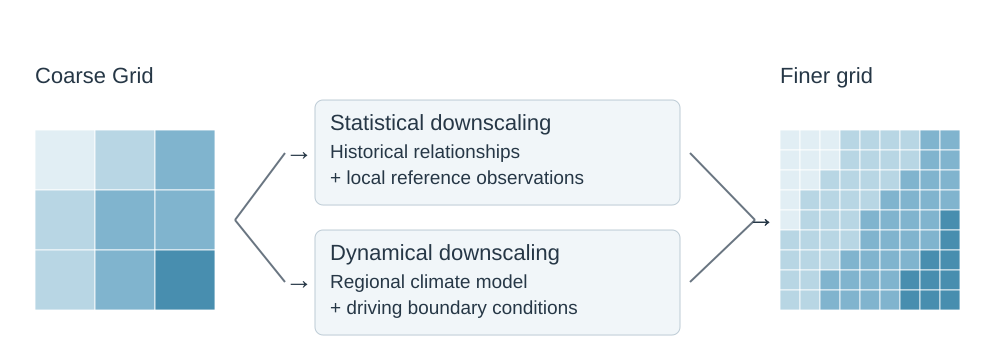
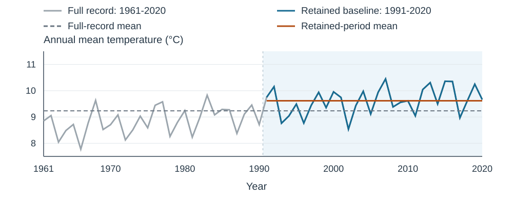
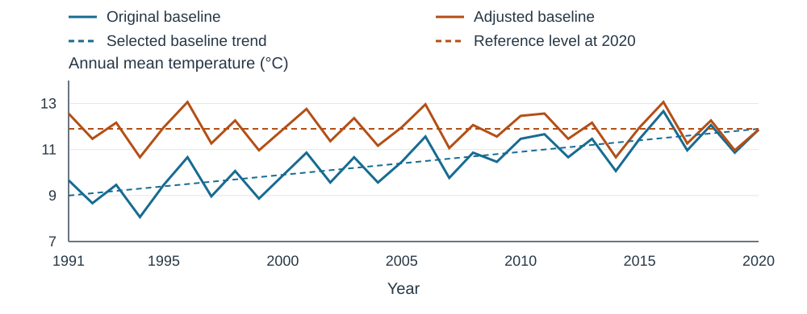
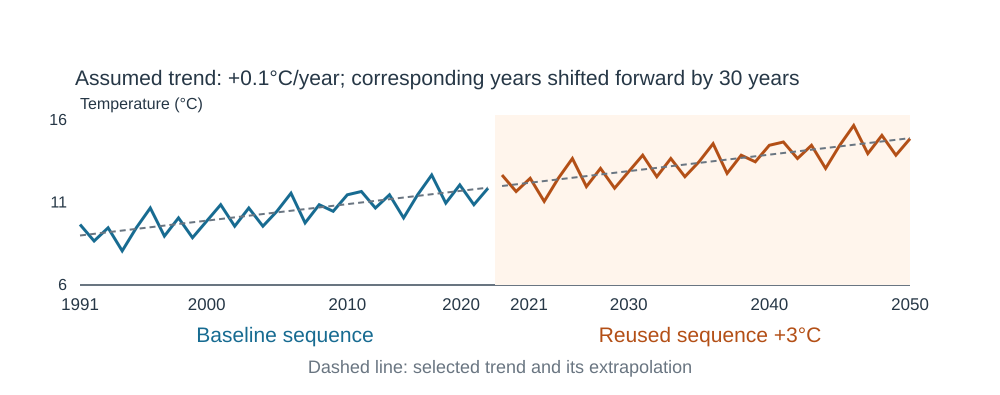

Data transformations modify the temporal or spatial representation and statistical properties of climate data to meet an application's needs. Examples include calculating catchment-average precipitation for hydrological modelling or the combination of time series with observations to address biases of climate model simulation data. A transformation should address a specific mismatch between the available data and the information required by the next model or analysis in a [modelling chain](../apply_climate_data/model_integration.qmd#modelling-chains).

This page summarizes selected approaches adapted from @Fournier2020, who discuss their strengths and limitations in more detail. These include using data without further modification, modifying a historical baseline (the reference time series used to represent past or current conditions), and processing climate-model simulations. They are not an exhaustive classification of transformations; routine operations such as unit conversion, aggregation, interpolation and indicator calculation are not detailed here.

@Fournier2020 discuss transformation methods for hydropower modelling; application to another electricity-sector decision requires checking the respective model's needs and the decision-relevant quantities. See [Integrating Climate Information into Models and Decisions](../apply_climate_data/model_integration.qmd) for the wider model-chain questions and [Climate Data Decision Tree](../datasets/Climate_Data_Decision_Tree.qmd) for selecting candidate data.

::: {.callout-tip title="Choosing Transformations for Decisions"}
Transformation methods are typically applied to meet the requirements of a model in a modelling chain and to align with the decision at the end of the chain. The following questions can help identify an appropriate approach:

- **Where is the handoff?** 
Identify the model, indicator calculation or analysis that will receive the dataset.
- **What does the next step require?** 
Specify variables, units, spatial coverage, time step, reference period, and any thresholds or dependencies it evaluates.
- **Which features matter to the decision?** 
These may include extremes, seasonal cycles, temporal sequence, or joint behaviour across variables (compound events).
- **Does the input meet those requirements?** 
If so, a direct handoff may be appropriate. If not, identify the specific mismatch and choose a method that addresses it.
- **What could the transformation change or discard?** 
Document the assumptions, compare relevant characteristics before and after processing, and decide whether the result remains fit for the intended use.

The seven approaches below are neither mandatory steps nor a prescribed sequence. Terminology may differ across fields.
:::

The following table indicates when each approach may be useful. Select an approach to read about its application, strengths and limitations.

| Approach | When to consider it |
|---|---|
| **[Direct use](#direct-use)** | The dataset already meets the requirements of the next model or analysis. |
| **[Downscaling](#downscaling)** | The application needs finer-scale spatial information. |
| **[Bias adjustment](#bias-adjustment)** | Selected simulation biases affect the indicators or impact model being used. |
| **[Delta](#delta-method)** | The analysis examines historical weather under modelled future climate changes. |
| **[Reduction](#reduction-method)** | Part of the historical record is unsuitable for the baseline being constructed. |
| **[Trend adjustment](#adjustment-method)** | Historical events need to be examined under selected, more recent climate conditions. |
| **[Extension](#extension-method)** | The analysis explores a conditional future scenario by extending a selected trend. |
| **[Aggregation](#aggregation-method)** | The application needs climate information for specific spatial units. |
: {.tbl .striped .light .sm tbl-colwidths="[25,75]"}

:::: {.callout-tip collapse="true" title="Compare potential strengths"}
This matrix highlights potential benefits. Methods can be combined, and the number of marked strengths does not indicate which approach is best.

**✓** = characteristic strength; **Conditional** = depends on the implementation or input data; **—** = not a main strength.

::: {style="overflow-x: auto;"}
::: {style="min-width: 850px;"}
| Potential strength | Direct use | Downscaling | Bias adjustment | Delta | Reduction | Trend adjustment | Extension | Aggregation |
|---|:---:|:---:|:---:|:---:|:---:|:---:|:---:|:---:|
| Preserves the numerical values of the data^1^ | ✓ | — | — | — | ✓ | — | — | — |
| Provides finer-scale spatial information | — | ✓ | — | — | — | — | — | — |
| Reduces selected systematic simulation biases | — | Conditional^2^ | ✓ | — | — | — | — | — |
| Supports analysis of different simulated weather sequences | Conditional^3^ | ✓ | ✓ | — | — | — | — | — |
| Supports comparison of historical events under changed conditions | — | — | — | ✓ | — | ✓ | ✓ | — |
| Makes a baseline more representative of selected recent conditions | — | — | — | — | ✓ | ✓ | — | — |
| Supports analysis of decision/process relevant spatial units | — | — | — | — | — | — | — | ✓ |
: {.tbl .striped .light .sm tbl-colwidths="[30,10,10,10,10,10,10,10]"}
:::
:::

^1^ Direct use passes values forward unchanged. Reduction excludes part of the record but leaves retained values unchanged.

^2^ Statistical downscaling may incorporate bias adjustment. Dynamical downscaling can reduce particular biases through improved process representation, but bias reduction is not guaranteed.

^3^ Direct use supports analysis of alternative simulated sequences when the input consists of climate simulations that already meet the application's requirements. It does not generate those sequences.

Based on @Fournier2020 (sections 3.1–3.6, pp. 52–65), supplemented by IPCC AR6 WGI Chapter 10 [@IPCC_2021_WGI_Ch10, section 10.3.3]. Checkmarks identify capabilities, not guaranteed improvements in accuracy or suitability.
::::

## Direct Use

Direct use means passing a dataset to the next model or analysis without further transformation. The dataset may contain observations, raw model output, or previously processed simulations.

:::: {.callout-note collapse="false" title="Strenghts and Limitations"}
**Strengths**

- **Simple to implement.** No additional transformation is needed at this step.
- **Avoids further processing changes.** The input dataset's values, event sequences and relationships among variables are retained.

**Limitations**

- **Existing limitations pass forward.** Biases, errors or unrealistic characteristics in the input dataset can affect the next model or analysis.
- **Does not resolve input mismatches.** Variables, units, spatial or temporal scales, and characteristics relevant to thresholds and extremes must already meet the application's requirements.

Use this approach when the dataset already meets the application's requirements (@Fournier2020, section 3.1, p. 52).
::::

## Downscaling

Downscaling produces climate information at finer spatial scales than the driving climate model. It may be useful where topography, coastlines or other regional processes materially affect an electricity-sector application. The required spatial detail depends on the decision; some assessments can use broader-scale information.

**Statistical downscaling** establishes empirical relationships between large-scale global climate model (GCM) variables and local climate observations, using historical data as a training base. Available methods are computationally efficient and have been widely used.

In contrast, **dynamical downscaling** refers to employing [regional climate models](../datasets/climate_projection_data/Climate_Projection_Datasets.qmd) (RCMs) which are driven by GCM output at their boundaries to explicitly simulate regional climate processes at a higher spatial resolution.

:::: {.callout-note collapse="true" title="Strenghts and Limitations"}
**Strengths**

- **Provides finer-scale information relevant to the application.** Downscaling can better represent regional or local differences associated with terrain, coastlines and other features.

**Limitations**

- **Finer resolution does not guarantee greater accuracy.** Results depend on the driving climate model and the downscaling method; biases and process limitations can remain.
- **Each approach has specific constraints.** Statistical downscaling depends on reference-data quality and assumes historical relationships remain applicable under future conditions. Dynamical downscaling is computationally demanding to produce and depends on how both the driving and regional models represent relevant processes.

Assess whether the additional detail improves the information needed for the application (@MaraunWidmann2018).
::::

{#fig-transformation-downscaling fig-alt="Coarse and fine grids are linked by separate statistical and dynamical downscaling pathways." width=100%}

## Bias Adjustment

Bias adjustment, also commonly called bias correction, uses observations or another reference dataset to reduce selected systematic biases in climate-model simulations. For example, a model may be consistently too warm or too cool, or misrepresent precipitation amounts or the number of wet days. Biases can arise from spatial resolution, process parameterization and other model limitations. Adjustment is particularly relevant when deriving threshold-based indicators or driving impact models calibrated to historical observations. In these applications, biases in the input data can lead to unrealistic responses.

Bias adjustment can be applied at the model's existing spatial resolution or combined with downscaling to produce finer-scale information. Both GCM and RCM outputs can contain systematic biases; dynamical downscaling does not remove the potential need for bias adjustment.

Univariate approaches adjust variables separately, whereas multivariate approaches also target relationships among variables (for example, concurrent temperature and humidity conditions relevant to electricity demand). Quantile mapping is a widely used family of bias-adjustment methods that adjusts simulated values according to their position in a statistical distribution. Methods differ in which properties they adjust and how they treat projected climate changes. Some are designed to preserve modelled changes in means or quantiles. Dataset documentation should describe these choices so users can assess their relevance to the application (@MaraunWidmann2018; @Menapace2025).

:::: {.callout-note collapse="true" title="Strenghts and Limitations"}
**Strengths**

- **Reduces selected systematic biases.** It can improve agreement with reference statistics, making simulations more suitable for threshold-based indicators and impact models calibrated to historical data.
- **Supports analysis of alternative simulated weather sequences.** Bias adjustment operates on climate simulations rather than the observed baseline. Different models and ensemble members therefore provide different sequences for analysis, although the adjustment may affect event durations and threshold exceedances.

**Limitations**

- **Depends on reference quality.** Errors in the reference data can carry into the adjusted product.
- **Historical adjustments may not hold under future conditions.** Relationships calibrated on historical data may change as the climate changes.
- **Does not correct every relevant property.** Extremes, persistence, spatial coherence and relationships among variables can remain unrealistic or be distorted.

Improved agreement with historical reference statistics does not guarantee realistic future conditions. Evaluate the properties that matter to the intended application (@Fournier2020, section 3.6, pp. 63-65; @MaraunWidmann2018; @Menapace2025).
::::

Several products documented in this guide have already undergone bias adjustment, including [ESPO-G6](../datasets/climate_projection_data/ESPO-G6.ipynb), [CanDCS-M6](../datasets/climate_projection_data/CanDCS-M6.ipynb), [CanLEAD](../datasets/climate_projection_data/CanLEAD.ipynb) and [NEX-GDDP-CMIP6](../datasets/climate_projection_data/NEX-GDDP-CMIP6.ipynb). See [Climate Projection Datasets](../datasets/climate_projection_data/Climate_Projection_Datasets.qmd) for an overview of GCMs, RCMs and the strengths and limitations of bias-adjusted products. Individual dataset profiles document product-specific processing and limitations.

For further reading, @Charron2016 and @Fournier2020 provide introductory explanations, @Menapace2025 reviews bias-adjustment methods in hydrology, and @MaraunWidmann2018 provides an in-depth discussion of statistical downscaling and bias adjustment for climate research. Open-source Python code for applying bias-adjustment methods is available in the [xsdba library](https://xsdba.readthedocs.io/en/latest/index.html).

{#fig-transformation-bias fig-alt="A single timeline shows reference observations during 1981 to 2010, an unadjusted simulation through 2080, and its adjusted counterpart shifted down by two degrees Celsius. The reference period is shaded and its means are marked with dashed lines." width=100%}

## Modifying Historical Data {#baseline-treatments}

These approaches modify the historical baseline used in an analysis. The choice depends on the purpose of the [baseline](../apply_climate_data/model_integration.qmd#climatic-baseline-selection) and the causes of any trends or discontinuities in the record.

### Delta Method {#delta-method}

The delta method is a simple and transparent way to combine a modelled climate-change signal with an observed historical time series (baseline). The change between historical and future periods in a climate-model simulation is calculated as a difference or ratio and then applied to observations. This preserves the baseline’s day-to-day sequence of events while imposing the modelled change to reflect projected climate conditions. The method can be applied to means of the distribution or its quantiles. Additive changes are commonly used for temperature, while multiplicative factors are often used for precipitation to avoid negative values. Multiple climate simulations of different models and [emissions scenarios](Emissions_scenarios.qmd) can be used to generate an [ensemble of future conditions](Ensembles.qmd). Since the method modifies the baseline, it is sometimes referred to as the perturbation method.

Delta methods modify a baseline, whereas bias adjustment modifies simulated values against a reference dataset. Mean-change deltas apply a change to the mean; quantile-based deltas can apply different changes across the distribution, including its tails. The method is commonly applied to [30-year reference and future periods](Time_horizons_GWL.qmd#temporal-horizon), although longer periods may be appropriate for some applications. For details on applying mean changes, see @Charron2016. For a broader explanation of quantile-mapping methods, see @MaraunWidmann2018.

:::: {.callout-note collapse="true" title="Strenghts and Limitations"}
**Strengths**

- **Simple for mean changes.** Differences or ratios from climate simulations can be applied directly to a baseline. Quantile-based variants allow changes to differ across the distribution but require more processing.
- **Enables controlled comparisons of climate impacts.** Applying projected changes to the same baseline events allows demand, generation or other system outcomes to be compared while holding the underlying weather sequence fixed.

**Limitations**

- **Reuses historical weather patterns.** Baseline errors and chronology carry forward; projected changes in event sequencing, persistence or new types of events are not automatically represented.
- **Results depend on the projected changes and the adjustment method.** Mean-change deltas can miss changes in variability and extremes. Quantile-based methods represent more of these changes, but still inherit errors in the modelled changes. Separate adjustments can also distort relationships between variables, such as the combination of temperature and humidity.

Evaluate these limitations against the intended application (@Fournier2020, section 3.5, pp. 60-62; @MaraunWidmann2018).
::::

{#fig-transformation-delta fig-alt="A single timeline shows a climate simulation from 1991 to 2065, a historical baseline during 1991 to 2020, and a shifted baseline scenario during 2036 to 2065. The future scenario repeats the baseline pattern with two degrees Celsius added, using the difference between simulated period means." width=100%}

:::: {.callout-tip collapse="true" title="Electricity-sector example: hourly future weather for power-system planning"}
Power system planning tools, including capacity expansion, production cost, and [resource adequacy models](../sectors/planning/resource_adequacy_planning.qmd), require hourly weather data as inputs to simulate the supply and demand of electricity. That input is often one or more years of weather data, each consisting of 8,760 hourly values of temperature, humidity, wind speed, and solar radiation. Traditionally, historical weather data were used, but this approach does not represent climate change and its impacts on the grid. As a result, climate projections are increasingly being integrated into power system models to capture the impacts of climate change and the range of plausible futures. Global Climate Models (GCMs) are the physics-based models used to project future climate and are the standard source of forward-looking data. However, the climate-projection datasets commonly used for these applications often provide daily rather than hourly data and therefore do not resolve the hourly weather patterns that drive peak loads, solar ramping in the morning and evening, the intermittency of wind, and storage needs. For example, sizing batteries to cover the hours after sunset on a hot evening requires knowing how temperature changes hour by hour, which is not attainable from daily data.

**Description of the method**

The Quantile Delta Change (QDC) method takes real historical hourly weather data, typically from weather stations or reanalysis data, and adjusts it by the change (“delta”) simulated by a climate model. For example, daily maximum temperature changes are computed by comparing the daily maximum temperature distribution from a climate model in a future period (e.g., 2036-2065 for target year 2050) to the historical daily maximum temperature distribution (e.g., 1996-2025). These differences are applied to historical daily maximum temperatures. The procedure is also applied to daily minimum temperatures, with a multivariate step accounting for their relationship with daily maxima. Each day's historical hourly profile is then rescaled between the adjusted minimum and maximum temperatures. This is computed separately for each quantile of the distribution and on a monthly basis to capture how the climate may change differently across seasons and across averages and extremes. Typically, the QDC approach is implemented across numerous climate models and emissions scenarios to capture the range of plausible futures. For more information, see @SmithDiazMardian2025.

{.lightbox #fig-qdc-hourly-example fig-alt="Quantile Delta Change example for Ottawa. The left panel compares historical and shifted July daily maximum temperature distributions, with different changes at the 10th, 50th and 90th percentiles. The right panel shows the historical hourly temperature profile for July 31, 2016 and a shifted profile for the 2050 climate under CanESM5 SSP3-7.0, with changed daily minimum and maximum temperatures." width=100%}

**Why this approach is useful**

This approach retains the realistic sequence, timing, and duration of weather events as the foundation for planning but adjusts it to reflect projected climate changes. The main benefits are:

- Critical patterns like the timing, magnitude, and duration of solar ramping rates and timing of peak temperatures are retained, while relying on modelled outputs may have unrealistic biases or artifacts that are not representative of local conditions.
- Temperature, humidity, wind speed, and solar radiation data remain physically linked, which matters for studies of stressful grid events when low wind, low solar, and high load occur together.
- It uses the change each climate model projects rather than its absolute temperatures. This can reduce the influence of some model biases, but does not guarantee that the projected changes are unbiased.
- Users have the option to use the unadjusted historical data when climate projections do not capture realistic variability, trends, or spatial patterns in a region, while most other methods would inherit errors and biases from climate models.
- The output has the same hourly format as the historical data planners already use, so the approach seamlessly integrates into existing planning tools.
- The method is computationally light, running on a personal computer in minutes.

**Limitations of the methodology**

QDC has several limitations that should be considered to determine if this approach is fit for purpose.

- QDC can only reshape weather patterns that have already occurred and cannot create new types of events. As a result, it may understate future extremes that fall outside the historical range. For instance, if an extreme event was absent from the historical record by chance, but occurs in the future, the power system models would not capture that event for consideration in grid planning.
- Each day's hourly shape comes from the historical record, so the method captures changes in the daily mean (and for temperature, the maximum and minimum) but not changes in the time of day when events occur, such as changes in the timing of maximum temperatures.
- For variables available only as daily averages, shifting the daily mean may not adequately represent changes in subdaily extremes.
- In cases where users choose to adjust some variables but not all (e.g., temperature but not wind and solar), the relationships between those variables lose coherence, and the size of that effect has not been measured.

::::

### Reduction {#reduction-method}

The reduction method consists of shortening a baseline period by excluding portions of a time series that are considered erroneous or unrepresentative of current conditions. It may be appropriate when statistical tests identify a significant trend or inhomogeneities, such as an abrupt change in the mean or a change in variance. Before reducing the period, these characteristics should be investigated, including their possible causes, since they may originate from factors other than climate change.

:::: {.callout-note collapse="true" title="Strenghts and Limitations"}
**Strengths**

- **May improve representativeness.** The retained period may better reflect the conditions relevant to the analysis.
- **May improve record homogeneity.** Excluding a period affected by a documented discontinuity may produce a more consistent record.

**Limitations**

- **Loses information.** Excluding years removes information about interannual variability and historical extremes and can increase sampling uncertainty.
- **Requires a justified period selection.** A statistically significant trend alone does not justify shortening the record. The causes of trends or discontinuities and the choice of retained period require investigation and justification.

These trade-offs should be assessed for the intended application (@Fournier2020, section 3.2, pp. 52-53).
::::

{#fig-transformation-reduction fig-alt="One time series spans 1961 to 2020. The retained 1991 to 2020 baseline is highlighted in blue. A dashed grey line marks the full-record mean and a solid orange line marks the retained-period mean." width=100%}

### Trend Adjustment (Detrending) {#adjustment-method}

The adjustment method modifies a baseline time series to remove a statistically significant trend and make it more representative of the conditions relevant to the analysis. A correction factor proportional to time is applied to the data. This factor can be derived directly from the baseline or from climate model simulations of the same period that account for climate change and other relevant drivers. The correction can be estimated for means or quantiles at annual, seasonal, monthly or daily scales, and the adjustment can be combined with other methods, such as bias correction or the delta method.

:::: {.callout-note collapse="true" title="Strenghts and Limitations"}
**Strengths**

- **Allows historical events to be examined in a more recent climate.** Adjusts historical values to account for the selected climate trend while retaining the sequence of events.

**Limitations**

- **The selected trend may not be appropriate to remove.** It can reflect climate change, natural variability, measurement changes or other influences. Statistical significance alone does not justify detrending.
- **Adjusts selected statistics, not every aspect of climate.** Removing a trend in means or quantiles does not independently represent changes in event sequencing, persistence or interannual variability.

Use detrending only when the analysis requires a baseline representing specified reference conditions (@Fournier2020, section 3.3, p. 54).
::::

{#fig-transformation-adjustment fig-alt="One panel overlays the original baseline and its upward trend in blue with the adjusted baseline and constant 2020 reference level in orange. Earlier values receive larger adjustments; the final value is unchanged." width=100%}

### Extension {#extension-method}

The extension method constructs a future scenario by extending a selected trend beyond the baseline period. It uses the same approaches to estimating and applying a time-dependent correction described under [Trend Adjustment (Detrending)](#adjustment-method), but applies the correction to represent future conditions.

If, for example, temperature has increased over the baseline period, the method can extend this trend into a future period by progressively adjusting the baseline values or parts of it. This produces a future-oriented time series while retaining the baseline data as its starting point.

:::: {.callout-note collapse="true" title="Strenghts and Limitations"}
**Strengths**

- **Simple to apply once a trend is selected.** A time-dependent correction can construct a conditional future scenario, although the trend and extrapolation horizon still require justification.
- **Enables controlled comparisons of climate impacts.** Applying an extrapolated trend to the same historical events allows system outcomes to be compared while holding the underlying weather sequence fixed.

**Limitations**

- **Assumes the selected trend remains applicable.** Historical trends may not persist or remain linear, particularly over longer horizons. Abrupt future changes are not captured.
- **Carries historical constraints forward.** Baseline errors and weather patterns are retained; extending a trend does not independently represent future changes in event sequencing, persistence or interannual variability.

State the extrapolation horizon and its physical justification; a statistically significant historical trend alone does not establish that it will persist (@Fournier2020, section 3.4, pp. 56-59; section 7.5.2, pp. 125-126).
::::

{#fig-transformation-extension fig-alt="A shared timeline separates the 1991-2020 baseline from a constructed future segment in 2021-2050, with reused fluctuations shifted by three degrees and a dashed extrapolated trend." width=100%}

## Spatial Aggregation {#aggregation-method}

Spatial aggregation combines gridded data or point observations into representative values for larger geographic units, such as administrative regions, watersheds or utility service territories. They are typically defined by polygon boundaries from GIS layers. It is useful for relating climate information to the geographic units used in infrastructure planning, impact assessment and resource management.

For gridded datasets (e.g. NetCDF or GeoTIFF), aggregation involves identifying the grid cells overlapping the polygon(s) and calculating statistics such as means, minima, maxima or sums. Where cells only partly overlap a polygon, area-weighted calculations can provide more representative results than treating all intersecting cells equally. This is particularly relevant for irregular boundaries, coastal regions and small polygons.

For station observations, the corresponding operation is generally to assign stations to the polygons in which they are located, then calculate statistics from the observations within each area. Simple averages may be used, although station representativeness and spatial distribution should be considered, as uneven station coverage can bias results.

The choice of statistic and weighting method depends on the variable and application. For example, area-weighted means may be suitable for temperature or precipitation, whereas sums may be appropriate for additive quantities. Spatial reference systems, polygon boundaries, grid resolution and partial cell overlaps should be considered. The resulting regional statistics or time series can serve as inputs to impact models or support comparisons between geographic units.

Spatial Aggregation may also refer to the combination of finer grid cells to a coarser grid.

Open Source Tools such as the geographic information system software [QGIS](https://qgis.org/) are available for data aggregation. [This tutorial](https://docs.qgis.org/3.44/en/docs/training_manual/processing/cutting_merging.html) explains how to clip a raster layer in QGIS. Python libraries such as [GeoPandas](https://geopandas.org/en/stable/) (geospatial vector data), [rioxarray](https://vylor.github.io/rioxarray/stable/)/[rasterio](https://rasterio.readthedocs.io/en/stable/) (geospatial raster data), [xESMF](https://xesmf.readthedocs.io/en/stable/index.html) (regridding) in combination with [xarray](https://xarray.dev/) (multi-dimensional arrays) are suited for geospatial operations for larger amounts of data. The [PAVICS](https://pavics.ouranos.ca) platform provides tutorials on [spatial subsetting](https://pavics.ouranos.ca/climate_analysis.html#b) and [regridding of raster data](https://pavics.ouranos.ca/climate_analysis.html#f).

![Spatial aggregation condenses gridded data or station observations into representative values for larger spatial units. (1) Grid to polygons: grid cells overlapping each polygon, such as an administrative region or watershed, are combined into one value per polygon, for example an area-weighted mean. (2) Spatial statistics: station observations are assigned to the polygon that contains them, and statistics such as mean, minimum, maximum and the 90th percentile (P90) are calculated for each polygon. (3) Coarser grid: groups of fine grid cells are combined into larger cells, for example by averaging, to give a coarser grid. Grid shading and values are schematic.](image/transformation_spatial_aggregation.svg){#fig-transformation-aggregation fig-alt="Data transformation to aggregate values to coarser spatial units or grids" width=90%}

::: {.callout-note collapse="true" title="Strenghts and Limitations"}
**Strengths**

- **Relevance to decision-making**. Provides climate statistics for geographic units used in infrastructure planning, watershed management or impact assessments.
- **Simplified analysis.** Reduces data volume and produces regional statistics or time series that are more fit for use in impact models, mapping, and spatial comparisons.

**Limitations**

- **Loss of spatial detail.** Aggregation masks local climate variations and may conceal important differences within geographic units, particularly where features like mountains or water bodies impact local climate.
- **Sensitivity to resolution and boundaries.** Results depend on input data resolution, polygon size and shape, and the treatment of partially overlapping grid cells.
- **Potential representativeness biases.** Uneven station distribution, missing data and inappropriate weighting methods can lead to misleading regional statistics.

Document resampling methods and ensure consistent use of GIS layers along the [modelling chain](../apply_climate_data/model_integration.qmd#modelling-chains).
:::

## Checking Fitness for Use
After any transformation, check that the data meet the requirements identified above:

- Confirm units, calendars, time steps and whether values represent means, totals or maxima/minima.
- Evaluate relevant extremes, event durations and relationships among variables and locations. Use consistent scenarios and model members when combining inputs.
- Record the reference dataset, method and previous processing, and document remaining limitations. Compare relevant properties before and after transformation (@Fournier2020).

## References

<strong>(click to expand)</strong>

::: {#refs}
:::

