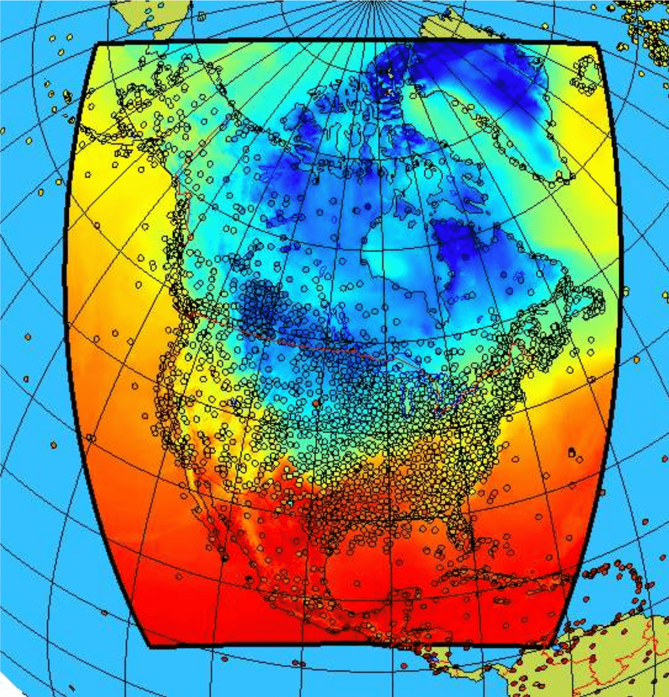

## Summary Description

The Canadian Surface Reanalysis (CaSR) is a high-resolution atmospheric reanalysis dataset produced by Environment and Climate Change Canada (ECCC). CaSR v3.2 is produced by dynamically downscaling [ECMWF's ERA5 global reanalysis](https://cds.climate.copernicus.eu/datasets/reanalysis-era5-single-levels) using operational models and configurations of ECCC's operational weather and environmental prediction system to provide historical, high-resolution climate and weather data over North America, with a focus on Canada. Surface observations of tempererature, humidity, snow depth and precipitation are integrated through the the Canadian Land Data Assimilation System (CaLDAS) coupled with the Canadian Precipitation Analysis (CaPA). CaSR is a consistent and seamless dataset providing the main meteorological variables coherent with in situ surface observations (@Gasset2021). Note that the CaSR dataset was previously known as RDRS (Regional Deterministic Reforecast System). Detailed description of the dataset are available in @Gasset2021 and @Khedhaouira2026.

{fig-alt="CaSR simulation domain with station locations" width=400}

## Dataset Characteristics

- **Current version:** v3.2
- **Available variables:** temperature, precipitation, wind, humidity, radiation, snow, surface pressure, sea level pressure, geopotential height (see [variables section below](#variables-available-in-casr))
- **Temporal coverage:** 1980–2024 (back extension 1968-1980 in production, @Gasset2026)
- **Temporal resolution:** Hourly and daily outputs  
- **Spatial coverage:** Canada and U.S.
- **Spatial resolution:** ~10 km grid spacing (0.09˚)
- **Data type:** A dynamical downscaling of ERA5 over the North and Central America domain using ECCC's Global Deterministic Reforecast System (GDRS), the global surface model (GEM-Surf) and the Regional Deterministic Reforecast System (RDRS), coupled with the CaLDAS surface assimilation system (@ECCC2025)
- **Data format:** [netCDF](../../climate_data_fundamentals/Data_Formats.qmd#netcdf)
- **Web references:**  
<a href="https://hpfx.collab.science.gc.ca/~scar700/rcas-casr/">ECCC Canadian Surface Reanalysis (CaSR) Web Site</a>,  
<a href="https://nordata.physics.utoronto.ca/en/annexes-datasets-descriptions/71-temperature/north-american-precipitation-and-land-surface-reanalysis-regional-deterministic-reforecast-system-rdrs/">Northern Climate Data Report and Inventory (NCDRI) Web Site</a>
- **Reference:**  @Gasset2021 @Khedhaouira2026
- **Contact:** [CaSR Helpdesk](mailto:DPS-Client@ec.gc.ca?subject=%5BRCaS-CaSR%5D%20Request:%20%3Cplease%20specify%3E&body=%3CPlease%20specify%20your%20request%3E%0A)

## When to use CaSR 

- When you need climate information about the **recent past**.
- When you need **spatial completeness** (e.g., basin-wide hydrology forcings).
- When you need variables not consistently available from stations (e.g. **radiation, near-surface winds**).
- When you need the **best precipitation** data over a **continuous region** of Canada.
- When you need to distinguish between **different types of precipitation**.
- When you need data at **hourly timescale**.
- When you need a historical dataset that is **consistent with future climate projections** available on <a href=https://portraits.ouranos.ca>Portraits Climatiques</a> and [ESPO-G6](../climate_projection_data/ESPO-G6.ipynb).

## Strengths and Limitations

### Key Strengths of CaSR

|Strength|Description|
|-|---|
|**High resolution**                     |~10 km grid spacing provides detailed spatial variability, better than global reanalyses.|
|**Hourly data availability**            |Useful for high-frequency climate and weather analysis.|
|**Assimilation of observed precipition**|Unlike other reanalysis products observed precipitation is assimilated to improve the agreement with station data.|
|**Detailed precipitation**              |Precipitation types are distiguished, including freezing rain.  Two versions of precipitation are provided: one purely modeled and the reanalysis version that assimilates measured precipitation data are provided.|  
|**Precipitation confidence index**      |A confidence index for precipitation informs on the weight of observations in the analysis.|
|**Consistent historical record**        |Spans over four decades, allowing for trend analysis and climate studies.|
|**Active development**                  |New versions and longer temporal record are in preparation.|  
: {.tbl .striped .light .sm tbl-colwidths="[25,75]"}

### Key Limitations of CaSR

|Limitation|Description|
|-|---|
|**Known biases**                           |CaSR is generally too wet and has an overall cold bias. See the [Expert Guidance Section](#expert-guidance) below.|  
|**Uncommon georeference**                  |The data are made available on a rotated grid which may be difficult to handle. The [PAVICS platform](https://pavics.ouranos.ca) hosts a [tutorial dedicated to the conversion of rotated grids](https://pavics.ouranos.ca/climate_analysis.html#f).|  
|**Limited to the surface or near-surface** |CaSR provides no data above 40m above surface.|
: {.tbl .striped .light .sm tbl-colwidths="[25,75]"}

## Expert Guidance {#expert-guidance}

::: {#id .callout collapse="true"}
### (click to expand)
The Canadian Surface Reanalysis (CaSR) dataset provides high-resolution, gridded climate data with seamless coverage across North America. CaSR has one of the highest spatial resolutions of gridded observational datasets over Canada and North America and it distinguishes itself from other reanalysis products through the assimilation of precipitation observations through the Canadian Precipitation Analysis (CaPA). It is therefore coherent with in situ observations of precipitation, absolute and dew point temperature and snow depth. The model used in the production includes a representation of lakes, which influence local climate. This feature is visible particularly in the shoulder season temperature fields and influences the thermal surface properties.

The CaPA system used to produce the gridded precipitation fields includes strict quality control procedures to avoid the assimilation of biased observations. This includes using wind speed to determine validity of solid precipitation measurements depending on the gauge type and weather station characteristics. Due to the complexity of the prodedure and difficulties with quality control radar data are currently not assimilated. Overall, CaSR was conceptualized for hydrological applications, where high-resolution precipitation and land-surface variables are critical (@Gasset2021).

For the East Boreal Region, @Gasset2026 show that emperature biases in CaSR exhibit an annual cycle with large errors during spring. When compared to the NRCANmet gridded observations, CaSR shows slightly warmer mean minimum temperatures and slightly colder mean maximum temperatures. As a result, the daily temperature range in CaSR is narrower than in NRCANmet. Air temperature biases are clearly correlated to elevation differences between nearby stations and the corresponding grid elevation. With improvement in the latest version of CaSR spring temperatures are higher and less biased in version 3.2 than in version 2.1. Pixels near water or mixed water/land pixels tend to exhibit a stronger cold bias. Overall, the magnitude of the biases varies by temperature variable and region, emphasizing the need for validation of the dataset at a particular location.

Precipitation in CaSR is generally positively biased, and this bias tends to increase with distance from the assimilated in-situ stations. Generally, reanalyses data tend to be too wet, with CaSR being wetter than ERA5-Land. Topography effects on precipitation is better resolved in CaSR than in ERA5-Land or NRCANmet. Due to the offline precipitation analysis, small inconsistencies can arise with other modeled fields such as radiation and humidity.

A study over British Columbia watersheds confirms CaSR's persistent cold bias alongside a wet bias. CaSR version 2.1 also shows drying trends in BC watersheds. The dataset proves skillful in capturing spatial mountain patterns and temporal trends (@Goswami2024).

Version 3.2 of CaSR represents a major improvement over version 2.1. It shows better agreement with surface observations across all variables, seasons, and domains. Precipitation performance is similar or slightly improved. Note that ECCC usually does standard performance tests on the model output of precipitation, not the analysis that also includes the observation assimilation while @Khedhaouira2026 assess precipitation from both the background field and the CaPA-24h analysis. Version 3.2 also assimilates up to 1,000 more observations per analysis, notably in winter above Canada (@Gasset2025) and it provides a new precipitation partitioning of total precipitation into rain and snowfall (as snow water equivalent - SWE), freezing rain and ice pellets. These partitions correspond to the total precipitation from the forecast model and are different from the improved total precipitation from the offline analysis through assimilation of observations using CaPA (see [CaSR - About preciptiation fields](https://hpfx.collab.science.gc.ca/~scar700/rcas-casr/dataset_specifics.html#champs_precip)).

A comparison of CaSR v3.2 and CaSR v2.1 (RDRS) winter (DJF) precipitation shows large differences over and around some large lakes in Manitoba (see figure below). Preliminary diagnostics indicate that these differences originate primarily from updates to the model background fields. In both versions, data assimilation tends to dry the background, but in v2.1, the assimilation of observations has a much larger (drying) effect, suggesting that v2.1 was likely too wet in these regions. The exact cause of the lake-related signature remains uncertain at this stage and note that these differences could appear over other lakes as well.

 winter (DJF) precipitation over and around lakes in Manitoba."){fig-alt="Difference of CaSR v3.2 and CaSR v2.1 (RDRS) winter (DJF) precipitation over and around lakes in Manitoba." width=700}

Preliminary analysis suggests that the time-dependant biases that were present in the previous version of CaSR (v2.1) have been corrected, increasing the confidence in trends that are detected using this dataset. However, because trends in CaSR 3.2 have not been fully validated, users are advised to validate such trends using a second dataset.

There was a bug in the assimilition of precipitation observations in version 3.1. The effect of the bug is very important over Quebec. This version should not be used for precipitation.

:::

## Variables available in CaSR

*For details click on variable group to uncollapse*

::: {#id .callout collapse="true"}
### Temperature
- Temperature [˚C]
- Dew point temperature [˚C]

Temperature variables are provided at 1h & 3h frequency and at levels 1.5 m, ~20m, and ~40m. For more details see the respective [table on the CaSR web site](https://hpfx.collab.science.gc.ca/~scar700/rcas-casr/dataset_specifics.html#available_variables).
:::

::: {#id .callout collapse="true"}
### Precipitation
- Quantity of daily precipitation [m]
- Confidence index of daily precipitation
- Quantity of hourly precipitation [m]
- Quantity of ice pellets (liquid water equivalent) [m]
- Quantity of freezing precipitation (liquid water equivalent) [m]
- Quantity of liquid precipitation [m]

Precipitation variables are provided at 1h and 24h frequency at the surface level. Two types of precipitation are available, one forecasted by the model and one generated by the offline precipitation reanalysis system.  For more details see the [section on precipitation fields](https://hpfx.collab.science.gc.ca/~scar700/rcas-casr/dataset_specifics.html#champs_precip) and the [data variables table](https://hpfx.collab.science.gc.ca/~scar700/rcas-casr/dataset_specifics.html#available_variables) on the CaSR web site.
:::

::: {#id .callout collapse="true"}
### Wind
- U-component of the wind (along the grid X axis) [kts]
- V-component of the wind (along the grid Y axis) [kts]
- Corrected U-component of the wind (along West-East direction) [kts]
- Corrected V-component of the wind (along South-North direction) [kts]
- Wind Modulus [kts]
- Meteorologial Wind direction [degree]

Wind variables are provided at 1h frequency and at levels 10m, ~20m, and ~40m. For more details see the respective [table on the CaSR web site](https://hpfx.collab.science.gc.ca/~scar700/rcas-casr/dataset_specifics.html#available_variables).
:::

::: {#id .callout collapse="true"}
### Humidity
- Relative humidity \[%]
- Specific humidity [kg/kg]

Humidity variables are provided at 1h frequency and at levels 1.5 m, ~20m, and ~40m. For more details see the respective [table on the CaSR web site](https://hpfx.collab.science.gc.ca/~scar700/rcas-casr/dataset_specifics.html#available_variables).
:::

::: {#id .callout collapse="true"}
### Radiation
- Downward solar flux [W/m^2^]
- Surface incoming infrared flux [W/m^2^]

Radiation variables are provided at 1h frequency at the surface level. For more details see the respective [table on the CaSR web site](https://hpfx.collab.science.gc.ca/~scar700/rcas-casr/dataset_specifics.html#available_variables).
:::

::: {#id .callout collapse="true"}
### Snow
- Water equivalent of snow depth over land subgrid tile [kg/m^2^]
- Snow depth over land subgrid tile [cm]

Snow variables are provided at 24h frequency at the surface level. For more details see the respective [table on the CaSR web site](https://hpfx.collab.science.gc.ca/~scar700/rcas-casr/dataset_specifics.html#available_variables).
:::

::: {#id .callout collapse="true"}
### Other Meteorological Variables
- Surface pressure [mb]
- Sea level pressure [mb]
- Geopotential height [dam]

These meteorological variables are provided at 1h frequency and (depending on variable) at surface level, ~20m, and ~40m. For more details see the respective [table on the CaSR web site](https://hpfx.collab.science.gc.ca/~scar700/rcas-casr/dataset_specifics.html#available_variables).
:::

## Data Access

CaSR data can be downloaded from the CaSPAr platform, the PAVICS platform or ECCC's high-performance computer GPSC-C. The CaSR website provides [instructions for these different download options](https://hpfx.collab.science.gc.ca/~scar700/rcas-casr/download.html).

To avoid downloading very large datasets in their entirety PAVICS allows partial/regional extraction and provides [a tutorial to do so](https://pavics-sdi.readthedocs.io/en/latest/notebooks/CaSR_basic.html). With a free PAVICS user account, the Jupyter notebook with the Python code in the tutorial can be [directly used on PAVICS](https://pavics.ouranos.ca/jupyter/hub/user-redirect/lab/tree/tutorial-notebooks/CaSR_basic.ipynb).

## References

::: {#refs}
:::

